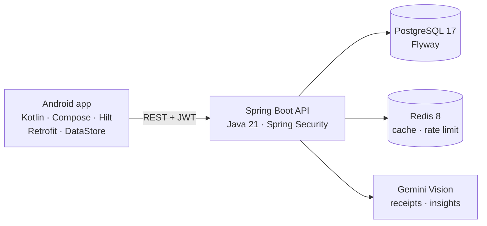

# FinOra

**A personal finance app that reads your receipts with AI** — native Android client (Kotlin, Jetpack Compose) on top of a Spring Boot REST API, with Gemini Vision turning a photo of a receipt into a transaction.

<!--
Screenshots: capture from the Android emulator, save under docs/screenshots/, then uncomment.

<p align="center">
  
  
  
  
</p>
-->

## Features

- **Authentication** — register/login with JWT access tokens and refresh tokens; the Android client refreshes automatically on `401`.
- **Budgets, categories and transactions** — full CRUD, default categories seeded on sign-up, budgets track real-time spending.
- **Dashboard and statistics** — income, expenses, balance, category breakdowns, daily/monthly trends and budget performance, drawn with custom Canvas charts.
- **Receipt scanning** — upload a photo or PDF; Gemini Vision extracts merchant, total, date, currency and category, and you confirm it into a transaction.
- **AI financial insights** — personalised spending advice generated from your own data (Gemini, with OpenAI behind the same interface).

## Architecture



The backend is organised by feature (`auth`, `transaction`, `budget`, `receipt`, `dashboard`, `statistics`…) with a layered controller → service → repository structure and DTO-based APIs. The Android app follows MVVM with Hilt-injected ViewModels.

More detail: [docs/ARCHITECTURE.md](docs/ARCHITECTURE.md) · [docs/PRD.md](docs/PRD.md) · [ADRs](docs/adr/)

## Running locally

Requires Docker. Compose starts PostgreSQL, Redis and the backend together.

```bash
cp .env.example .env    # fill in the values below
docker compose up --build
```

| Variable | Description |
|---|---|
| `DB_PASSWORD` | PostgreSQL password |
| `JWT_SECRET` | JWT signing key, **at least 32 bytes** — generate with `openssl rand -base64 48` |
| `GEMINI_API_KEY` | Google Gemini API key |
| `OPENAI_API_KEY` | OpenAI API key |

- API: `http://localhost:8080`
- Swagger UI: [`http://localhost:8080/swagger-ui.html`](http://localhost:8080/swagger-ui.html)

**Android:** open `android/` in Android Studio and run it on an emulator. The default `BASE_URL` is `http://10.0.2.2:8080`, which reaches the Docker backend on the host machine.

## Technical decisions

- **Flyway for schema changes** — the schema is built only from versioned SQL migrations (`ddl-auto: none`), so every environment gets the same database and every change is reviewable in Git.
- **Redis cache for AI insights** — each user's generated insight is cached in Redis and invalidated whenever their transactions or budgets change, so repeat dashboard loads don't call the LLM.
- **Rate limiting AI requests** — a per-user Redis key with a 60-second TTL (`SET NX`) allows one fresh insight generation per minute, which caps API cost and abuse without extra infrastructure.

## Tech stack

| | |
|---|---|
| **Android** | Kotlin, Jetpack Compose (Material 3), Hilt, Retrofit + OkHttp, DataStore |
| **Backend** | Java 21, Spring Boot 3.5, Spring Security, JPA/Hibernate, springdoc-openapi |
| **Data** | PostgreSQL 17, Redis 8, Flyway |
| **AI** | Google Gemini (Vision + text), OpenAI |
| **Infra** | Docker, Docker Compose |
